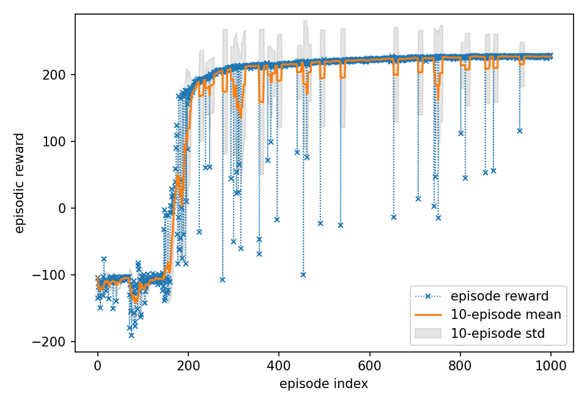
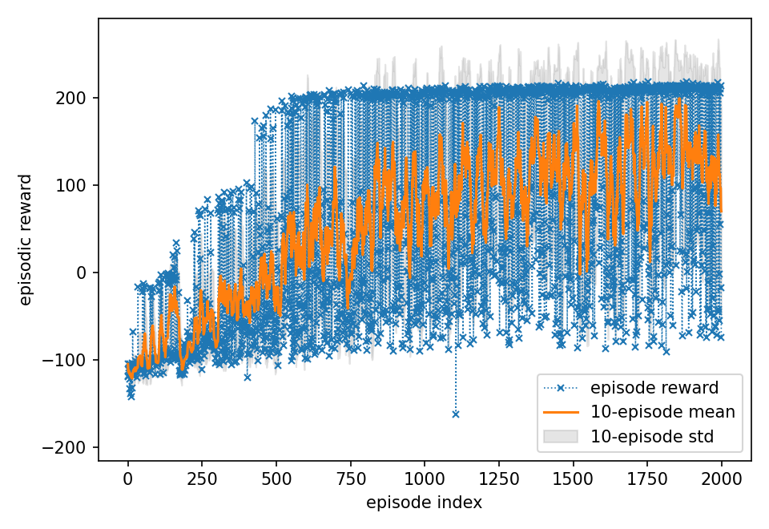

# The Walking Dead-Ends

*Avoiding local optima in TD3-based bipedal learning*

This project trains a bipedal robot to walk, and eventually run, using deep reinforcement learning. The agent is based on Twin Delayed Deep Deterministic Policy Gradient (TD3) and learns from scratch in the rldurham Walker environment, a Box2D variant of Gymnasium's BipedalWalker, across both an easy mode and a hardcore mode with stairs, stumps and pits. Sample efficiency was the primary objective, so each design decision was judged by how quickly and reliably it produced a fast, stable gait within a fixed episode budget.

| Easy mode (episode 914, reward 227.6) | Hardcore mode (episode 1916, reward 212.9) |
|---|---|
|  |  |

## Headline Results

| Mode | Episodes | First episode above 200 | Best episode | Late-stage performance |
|---|---|---|---|---|
| Easy | 1,000 | 248 (~195k steps) | 229.3 | Mean of 226 over the final 100 episodes, with 99% above 200 |
| Hardcore | 2,000 | 550 (~189k steps) | 218.6 | Median of 207 over the final 500 episodes, with 58% above 200 |

Step counts are cumulative environment steps taken from the training logs.

## Repository Contents

| File | Description |
|---|---|
| `xtzv61-agent-code.ipynb` | TD3 agent and training loop for easy mode |
| `xtzv61-agent-code-hardcore.ipynb` | Hardcore agent with n-step returns, action smoothing and an episode-length curriculum |
| `xtzv61-agent-log.txt`, `xtzv61-agent-log-hardcore.txt` | Per-episode reward and length logs for both runs |
| `xtzv61-agent-video*.mp4` | Full recordings of the best recorded episode in each mode |
| `xtzv61-agent-paper.pdf` | Short paper covering methodology, ablations and limitations |
| `assets/` | GIFs and training curves used in this README |

## Approach

The agent extends a provided SAC starter template into a TD3 implementation, with CleanRL's TD3 serving as a conceptual reference. TD3 limits overestimation bias in actor-critic methods by combining clipped double Q-learning, delayed policy updates and target policy smoothing. I developed the agent in two stages, and every significant change was evaluated across three random seeds before being retained.

### Easy Mode

- **Stable network design.** The 400-300 actor and critic networks use orthogonal initialisation, small final-layer weights and critic gradient clipping.
- **Online updates.** Performing a gradient step after every environment step, instead of after each full episode, reduced training lag at the cost of slightly higher variance.
- **Replay and warmup.** A 3M-transition buffer, a batch size of 256 and 10,000 random warmup steps each gave modest gains in convergence speed.
- **Fixed exploration noise.** A static Gaussian noise of 0.2 matched the stability of decaying schedules and was therefore preferred for its simplicity.

### Hardcore Mode

The tuned easy-mode configuration kept a rolling mean below zero over 2,000 hardcore episodes, so I extended it with four mechanisms.

- **n-step returns (n = 3)** with a tail flush at episode boundaries and a dynamic γ<sup>n</sup> for shorter sequences near termination.
- **An episode-length curriculum** that caps episodes at 300, 600 and then 1,000 steps before removing the cap at episode 700, selected from eight candidate schedules.
- **Action smoothing** through an exponential moving average over consecutive actions (α = 0.93), applied before exploration noise is added.
- **Tuned target policy smoothing** (σ = 0.18, clipped at 0.30) and reward clipping to [-10, 10], which softened the impact of extreme fall penalties.

Prioritised experience replay, TD3+BC regularisation, a CAPS smoothness penalty, a third critic and Huber loss were also trialled but discarded, as each either failed to improve on or degraded the baseline.

## Training Curves

| Easy mode | Hardcore mode |
|---|---|
|  |  |

In easy mode, the agent first exceeded a reward of 200 at episode 248 and then remained highly stable, averaging 226 over the final 100 episodes. Hardcore mode shows a three-phase trajectory that mirrors the curriculum, with episode caps lifted progressively until episode 700 and the median reward continuing to rise afterwards. However, variance remains high, as roughly a fifth of late hardcore episodes still end below zero, typically through a fall on an unfamiliar obstacle configuration.

## Key Learnings

- **Structured difficulty made hardcore mode tractable.** The tuned easy-mode agent remained below zero on hardcore terrain, whereas the episode-length curriculum helped it learn basic locomotion before facing full-length episodes.
- **Smoothing helps only at the right strength.** An α of 0.93 produced the best hardcore curve, whilst heavier smoothing distorted the policy signal and an α of 0.97 over-constrained early exploration.
- **Published techniques do not always transfer to online learning.** TD3+BC is designed for offline data, so without demonstrations it biased the policy away from exploration, and the poor results from prioritised replay may be attributable to importance-sampling correction interacting with fast-moving targets.
- **Simpler choices often matched complex ones.** Fixed exploration noise performed as well as decaying schedules, and wider networks added training time without a measurable benefit.

## Limitations

Hardcore performance retains high episodic variance, which is likely attributable to out-of-distribution obstacle configurations. Training was also CPU-bound at four to six hours per run, which restricted the number of ablations, and sequential single-variable tuning cannot capture interactions between jointly sensitive hyperparameters. Curiosity-driven exploration, population-based training and Bayesian optimisation are promising directions for future work.

## Running the Notebooks

Both notebooks run on a CPU, as the Box2D simulation is the main computational bottleneck. The dependencies can be installed with the following command.

```bash
pip install swig rldurham torch
```

Each run is seeded with 42 through rldurham's helper, and a full hardcore run of 2,000 episodes takes several hours.

## References

Full references are listed in `xtzv61-agent-paper.pdf`. The implementation draws primarily on TD3 (Fujimoto et al.), CleanRL's TD3 reference implementation (Huang et al.), n-step returns (Sutton and Barto) and the n-step logic in Stable-Baselines3.
